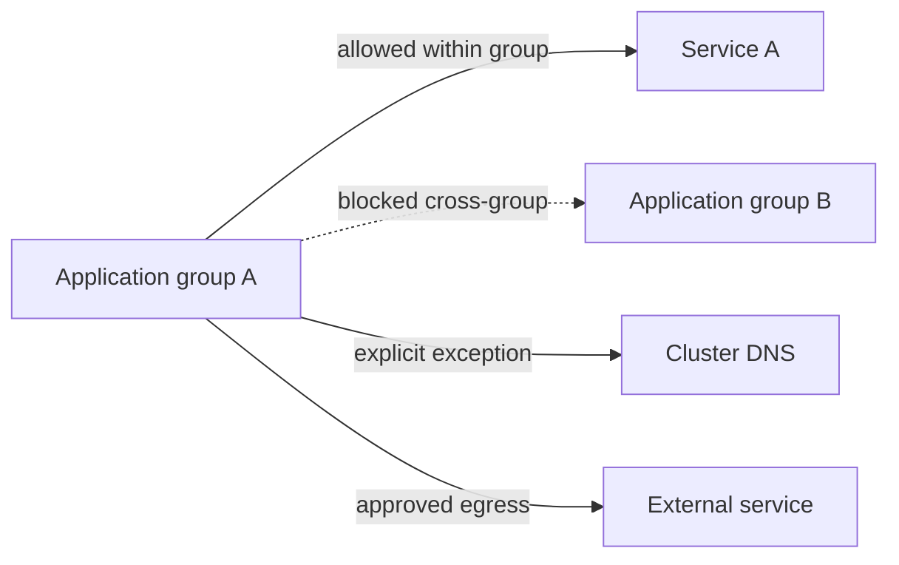

# Kubernetes Network Isolation with Cilium

**Type:** Production experience, illustrated with independently written examples.

## Problem
Shared Kubernetes clusters need clear isolation between application groups while preserving DNS, ingress, monitoring, and required platform services. A blanket deny rule can break workloads unexpectedly.

## Approach
1. Identify application groups using controlled namespace labels.
2. Establish a policy baseline and explicitly enumerate allowed paths.
3. Allow same-group traffic while restricting cross-group connections.
4. Define platform exceptions (DNS, ingress, health probes, monitoring) deliberately.
5. Validate with positive and negative connectivity tests and observe policy verdicts.

## Engineering decisions
- **Namespace labels:** easier to apply across a business-unit group than duplicating every pod selector.
- **Clusterwide vs namespaced policies:** broad baselines require careful review; narrow rules reduce accidental blast radius.
- **DNS:** explicitly permit queries to CoreDNS when an egress policy isolates workloads.
- **Validation:** test both allowed and denied flows. DNS resolution succeeding does not imply TCP connectivity.

## What I learned
Default-deny projects are primarily an exercise in dependency discovery and rollout safety, not just YAML authoring. Start in non-production, inspect flows, then stage changes incrementally.

**Reproduce:** [Cilium policy lab](../labs/cilium-policy.md). This page does not expose any employer-specific topology or policy manifests.
