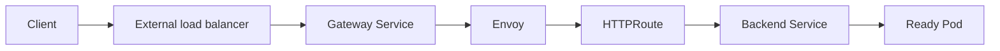

# Troubleshooting Gateway API: Accepted Is Not Reachable

**Type:** Evaluation / proof of concept; not a claim of a production Cilium Gateway rollout.

## Symptoms explored
A GatewayClass and Gateway can report accepted/programmed status while external clients see connection refusal, and in-cluster requests may return an Envoy HTTP 503. These observations indicate different failure boundaries.



## Diagnostic sequence
```bash
kubectl get gatewayclass
kubectl get gateways -A
kubectl get httproutes -A
kubectl describe gateway -n demo demo-gateway
kubectl get svc,endpointslices -n demo
kubectl get pods -n demo -o wide
```

Check the actual Gateway namespace, controller ownership, route `Accepted`/`ResolvedRefs` conditions, backend Service ports, EndpointSlices, and readiness. When testing hostname routes, pass the expected Host header:

```bash
curl -v -H 'Host: app.example.test' http://GATEWAY_ADDRESS/
```

## Key lessons from evaluation
- Control-plane status does not prove external data-plane connectivity.
- An external connection refusal points earlier in the chain than an Envoy-generated 503.
- Enterprise load-balancer integrations may require Service annotations or a supported controller configuration.
- Cilium Gateway API support is version/configuration dependent; a tested setup required kube-proxy replacement, which was not enabled in that environment. This does **not** mean Gateway API generally requires kube-proxy replacement.
- Avoid changing a working ingress controller merely to prove out a second Gateway implementation; isolate the evaluation.

**Outcome:** The evaluated Cilium Gateway approach was not adopted in that environment. The investigation clarified controller ownership, LB integration, and data-plane prerequisites.
