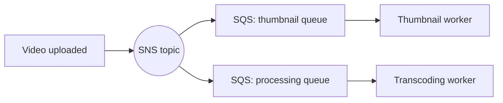
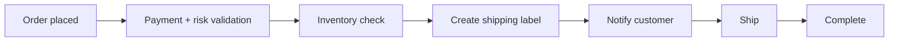

# AWS Application Integration Services

Quick revision notes for the Solutions Architect exam. These services connect, scale and decouple the parts of an application. The table below gives one line per service; the sections after it go deeper on the ones that show up most in questions.

## At a glance

| Service | One-liner |
|---|---|
| **EC2 Auto Scaling** | Adds or removes EC2 instances automatically to match demand and replaces unhealthy ones |
| **Elastic Load Balancing** | Spreads incoming traffic across healthy targets in multiple AZs (ALB, NLB, GWLB) |
| **API Gateway** | Managed front door to create, secure, throttle and monitor REST, HTTP and WebSocket APIs |
| **AppFlow** | No-code data transfer between SaaS apps (Salesforce, SAP, Slack…) and AWS services |
| **SNS** | Pub/sub **push** messaging. One message to a topic fans out to many subscribers |
| **SQS** | Fully managed **queue** (pull). Decouples producers from consumers and buffers load |
| **Amazon MQ** | Managed ActiveMQ / RabbitMQ broker for apps that use standard protocols (JMS, AMQP, MQTT) |
| **EventBridge** | Serverless event bus that routes events from AWS, your apps and SaaS partners to targets |
| **SES** | Send (and receive) transactional, marketing and bulk email |
| **Step Functions** | Serverless visual workflows (state machines) that coordinate AWS services |
| **SWF** | Older workflow service where you write the coordination logic in code |
| **MWAA** | Managed Apache Airflow for Python DAG-based data pipelines |

---

## Scaling & load balancing

### EC2 Auto Scaling

Automatically adds or removes EC2 instances in an **Auto Scaling group (ASG)** so you have the right capacity at the right cost.

- Settings: **minimum / desired / maximum** capacity; instances are built from a **launch template**.
- Spans **multiple AZs** and rebalances across them for high availability.
- **Health checks**: EC2 status checks by default; turn on **ELB health checks** so instances failing the app check are replaced too.
- **Scaling policies**:

| Policy | How it works | Use |
|---|---|---|
| **Target tracking** | Keep a metric at a target, e.g. average CPU at 50% | Simplest, the usual answer |
| **Step / simple** | Add/remove N instances when a CloudWatch alarm fires | Finer control over big jumps |
| **Scheduled** | Change capacity at set times | Known patterns, e.g. 9 am weekday ramp-up |
| **Predictive** | ML forecasts load from history and scales ahead of time | Regular daily/weekly cycles |

- **Cooldown / instance warm-up** stops the group from scaling again before new instances are ready.
- **Lifecycle hooks** pause instances on launch or terminate to run custom actions (install software, drain logs).
- **Warm pools** keep pre-initialised instances ready to cut scale-out time.
- **Instance refresh** rolls out a new launch template across the group.
- Common pattern: scale workers on **SQS queue depth** (`ApproximateNumberOfMessagesVisible`, or backlog per instance).

### Elastic Load Balancing (ELB)

Spreads incoming traffic across multiple targets (EC2, containers, IPs, Lambda) in one or more AZs.

| Load balancer | OSI layer | Key features | Typical use |
|---|---|---|---|
| **Application LB (ALB)** | Layer 7 (HTTP/HTTPS, gRPC, WebSocket) | Path-, host- and header-based routing; Lambda targets | Web apps, microservices, containers |
| **Network LB (NLB)** | Layer 4 (TCP/UDP/TLS) | Ultra-low latency, millions of req/s, **static IP / Elastic IP per AZ**, preserves source IP | Gaming, IoT, non-HTTP, partners who must allow-list a fixed IP |
| **Gateway LB (GWLB)** | Layer 3 (IP, GENEVE) | Sends traffic through third-party appliances | Firewalls, intrusion detection |
| Classic LB | L4/L7 | Legacy | Avoid for new designs |

!!! note "Elastic IPs with NLB"
    An NLB can take **one Elastic IP per AZ**, so clients get a **fixed public IP** (handy for firewall allow-lists). ALBs only give you a DNS name. Their IPs change.

**Features worth knowing**

- **Health checks** send traffic only to healthy targets.
- **SSL/TLS termination** with certificates from **ACM**; **SNI** lets one ALB/NLB serve many certificates/domains.
- **Sticky sessions** keep a user on the same target (cookie-based on ALB).
- **Cross-zone load balancing** spreads traffic evenly across all targets in all AZs (on by default for ALB, off by default for NLB).
- **Deregistration delay** (connection draining, default 300 s) lets in-flight requests finish before a target is removed.
- The ALB passes the client IP in the **`X-Forwarded-For`** header.

---

## APIs & SaaS data flows

### Amazon API Gateway

- Fully managed service to **create, publish, secure and monitor APIs** at any scale.
- API types: **REST API** (most features), **HTTP API** (cheaper, simpler, lower latency), **WebSocket API** (two-way, real-time, e.g. chat apps).
- **Endpoint types**: **Edge-optimised** (through CloudFront, for global clients), **Regional** (clients in the same Region), **Private** (only from your VPC through an interface endpoint).
- Features: throttling/rate limits, **caching** (default TTL 300 s), request validation, **API keys & usage plans** (per-customer quotas), **stages** (dev/prod) with stage variables, canary releases.
- Auth: **IAM**, **Amazon Cognito user pools**, **Lambda authorizers** (custom tokens). Add **AWS WAF** for protection.
- Limits to remember: **29 s** default integration timeout, **10 MB** payload, account throttle of **10,000 requests/s** per Region (burst 5,000) by default.
- Classic serverless pattern (CRUD demo): **API Gateway → Lambda → DynamoDB**.

### Amazon AppFlow

- **No-code, fully managed data transfer between SaaS apps and AWS services** (e.g. Salesforce, SAP, Slack, Zendesk, ServiceNow ↔ S3, Redshift).
- Runs on demand, on a schedule, or on an event; can filter, map and validate data.
- Data encrypted in transit and at rest; can use **AWS PrivateLink** so traffic stays off the public internet.

!!! tip "Exam tip"
    "Get Salesforce/SaaS data into S3 or Redshift without writing code" → **AppFlow**.

---

## Messaging & events

### Amazon SNS & Amazon SQS

| | **SNS** (Simple Notification Service) | **SQS** (Simple Queue Service) |
|---|---|---|
| Model | **Pub/Sub**, **push**. A publisher sends to a **topic**, and every subscriber gets a copy | **Queue**, **pull**. Consumers poll and process messages |
| Delivery | To SQS, Lambda, HTTP(S), email, SMS, mobile push, Firehose | One consumer processes each message |
| Persistence | No storage. Messages are delivered and gone | Messages kept until deleted (default 4 days, **max 14 days**) |
| Use | Fan-out, notifications, alerts | Decouple producers from consumers, buffer load, smooth spikes |

**SNS key facts**

- **Standard topics** (very high throughput) and **FIFO topics** (strict ordering, deduplication; deliver to SQS queues).
- **Message filtering**: a subscription policy means each subscriber gets only the messages it cares about.
- Encryption with KMS; access policies let other accounts or services (e.g. S3 events) publish.

**SQS key facts**

- **Standard queue**: nearly unlimited throughput, **at-least-once** delivery, best-effort ordering.
- **FIFO queue**: **strict ordering**, **exactly-once** processing, lower throughput (300 msg/s, 3,000 with batching; higher in high-throughput mode). Name must end in `.fifo`.
- **Visibility timeout** (default 30 s, max 12 h): hides a message while a consumer works on it. If processing takes longer, the message reappears and may be processed twice.
- **Dead-letter queue (DLQ)**: collects messages that keep failing (after `maxReceiveCount` attempts).
- **Long polling** (wait up to 20 s) cuts down empty responses and cost.
- **Delay queues** hold new messages back for up to 15 minutes.
- Message size up to **1 MiB** (older material says 256 KB); for bigger payloads store them in S3 with the **SQS Extended Client Library**.
- Scale consumers (EC2 ASG, ECS, Lambda) on **queue depth**.

**Fan-out pattern (SNS + SQS)**: one event, several independent consumers.

Each queue gets its own copy of the message, so a slow or failed worker doesn't affect the others.

### Amazon MQ

- Managed message broker for **Apache ActiveMQ** and **RabbitMQ**.
- Supports industry-standard protocols: **AMQP, MQTT, OpenWire, STOMP, JMS**. Apps written in different languages and frameworks can talk through a common protocol.
- Best for **migrating existing on-prem apps** that already use a broker (lift and shift, no code rewrite).
- HA: ActiveMQ **active/standby** across two AZs with shared storage; RabbitMQ **cluster** of 3 nodes across AZs.
- Runs on broker instances, so it doesn't scale as far as SNS/SQS.
- For **new cloud-native apps**, SNS + SQS is usually the better choice: simpler, serverless, and scales almost without limit.

!!! tip "Exam tip"
    "Migrate an app that uses JMS / AMQP / MQTT / RabbitMQ / ActiveMQ" → **Amazon MQ**. Otherwise → **SNS / SQS**.

### Amazon EventBridge

Serverless **event bus** that connects applications using events. Producers and consumers don't need to know about each other, so tightly coupled apps can become **loosely coupled**.

| Component | What it does |
|---|---|
| **Event bus** | Receives events from AWS services (default bus), your own apps (custom bus), or **SaaS partners** (partner bus). **Rules** match events by pattern and route them to targets (Lambda, SQS, Step Functions, etc.) |
| **Pipes** | **Point-to-point** integration: source → filter → enrich/transform → target, no glue code needed |
| **Scheduler** | Serverless scheduler (cron, rate, or one-time) for millions of schedules, with **retries** and DLQ |

**Features**

- Low-cost, serverless integration (pay per event).
- **Archive & Replay**: store events and replay them later for debugging or recovery.
- **Schema Registry**: discovers and stores event structures and generates code bindings.
- Built-in **retries** and dead-letter queues.
- **Cross-account / cross-Region** event delivery to a central bus.

!!! note "EventBridge vs SNS"
    Both route events to many targets. EventBridge offers **richer content-based filtering**, **SaaS sources**, schema registry and replay. SNS has **higher throughput / lower latency** and direct SMS, email and mobile push.

### Amazon SES (Simple Email Service)

- Cloud email service that runs on AWS infrastructure: **transactional** (receipts, password resets), **marketing**, and bulk email; can also **receive** email.
- Integrates with SNS, S3, Lambda; send via SMTP or API.
- Deliverability tools: **SPF, DKIM, DMARC**, reputation dashboard, dedicated IPs.
- New accounts start in a **sandbox** (verified recipients only) until you request production access.

!!! tip "Exam tip"
    SNS can send a plain email notification to subscribers. For real application email (HTML, bulk, custom domains, bounce handling) → **SES**.

---

## Workflow orchestration

### AWS Step Functions

Serverless **visual workflow orchestration**. It solves the problem of coordinating complex workflows that span many components and services.

- Workflows are **state machines** defined in **Amazon States Language (JSON)**; you can inspect every execution step by step in the console.
- State types: Task, Choice (branching), **Parallel**, **Map** (loop over items), Wait, Pass, Succeed/Fail.
- **Error handling** is built in: `Retry` (with backoff) and `Catch` (fallback / escalation paths).
- **Human approval** steps via callback with a task token.
- Integrates with **220+ AWS services** and **10,000+ API actions**.

| Workflow type | Max duration | Execution guarantee | Use |
|---|---|---|---|
| **Standard** | Up to 1 year | Exactly-once | Long-running jobs, ETL, human approval |
| **Express** | Up to 5 minutes | At-least-once | High-volume, short event processing (IoT, streaming) |

**Example: order processing workflow**

Other use cases: long-running **ETL jobs**, **automations that need manual approval**, ML pipelines, microservice orchestration.

### Amazon SWF (Simple Workflow Service)

- The older workflow service. **You write the coordination logic in code** (deciders + activity workers) in a programming language of your choice.
- Choose SWF when you need **child workflows (child processes)**, **external signals** to step into a running workflow, or **interaction with outside entities / human tasks** that require custom code.
- AWS recommends **Step Functions for new applications**.

### Amazon MWAA (Managed Workflows for Apache Airflow)

- Managed **Apache Airflow**. AWS runs the scheduler, workers and web server, and **scales workers automatically** on managed infrastructure.
- Workflows are **DAGs written in Python**, stored in S3.
- Best for teams **already using Airflow**, or for complex data/ETL pipelines that need the open-source Airflow ecosystem and plugins.

### Choosing a workflow service

| Requirement | Pick |
|---|---|
| New serverless workflow, visual, deep AWS integration | **Step Functions** |
| Child workflows, external signals, custom code-driven coordination | **SWF** |
| Existing Airflow DAGs / open-source portability, Python data pipelines | **MWAA** |

---

## Quick decision cheat sheet

| Scenario | Answer |
|---|---|
| Match EC2 capacity to demand | EC2 Auto Scaling (target tracking) |
| Scale workers by backlog | Auto Scaling on SQS queue depth |
| Fixed IP for a load balancer | NLB with Elastic IPs |
| Path-based HTTP routing | ALB |
| Route traffic through firewall appliances | Gateway LB |
| Expose a REST/WebSocket API in front of Lambda | API Gateway |
| Per-customer API quotas | API Gateway usage plans + API keys |
| Sync SaaS data (Salesforce, etc.) to AWS without code | AppFlow |
| Decouple components with a buffer | SQS |
| One message to many subscribers | SNS (fan-out to SQS) |
| Strict ordering, no duplicates | SQS FIFO |
| Messages that keep failing | Dead-letter queue |
| Migrate an app using ActiveMQ/RabbitMQ | Amazon MQ |
| React to AWS/SaaS events, content-based routing | EventBridge |
| Run tasks on a schedule (serverless) | EventBridge Scheduler |
| Send transactional / marketing email | SES |
| Orchestrate multi-step workflow with retries & approvals | Step Functions |
| High-volume, short-lived workflows | Step Functions Express |
| Child workflows / external signals in code | SWF |
| Existing Airflow DAGs | MWAA |
