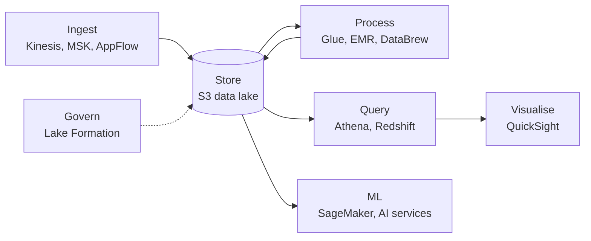

# AWS Data, Analytics & ML Services

Quick revision notes for the Solutions Architect exam. Each section starts with a table (what the service does, the problem it solves, an example) and then goes deeper on the services that show up most in questions.

---

## Streaming & ingestion

| Service | What it does | Problem it solves | Example |
|---|---|---|---|
| **Kinesis Data Streams** | Real-time stream you read with your own consumers; data kept 24 h (up to 365 days) and can be replayed | Process large event streams within milliseconds | Clickstream → Lambda updates a live dashboard |
| **Amazon Data Firehose** (was Kinesis Data Firehose) | Fully managed delivery of streams to S3, Redshift, OpenSearch, Splunk; buffers and can transform | Load streaming data into storage with no code. Near real time (buffered), not instant | SDK app sends stock ticks → Firehose → S3 |
| **Kinesis Video Streams** | Ingests and stores video/audio streams from devices | Capture camera feeds for playback or ML analysis | Doorbell camera → Kinesis Video → Rekognition |
| **Managed Service for Apache Flink** (was Kinesis Data Analytics) | Runs SQL / Flink apps on streaming data | Analyse a stream while it flows | Fraud alert when 5 card swipes happen within 1 minute |
| **Amazon MSK** | Managed Apache Kafka (provisioned or serverless) | Run Kafka without managing brokers and ZooKeeper | Move an on-prem Kafka pipeline to AWS without rewriting it |

!!! tip "Exam tip"
    "Real time, custom processing" → **Data Streams**. "Load into S3/Redshift, least effort" → **Firehose**. "Already on Kafka" → **MSK**.

### Kinesis Data Streams: key details

- A stream is made of **shards**. Each shard takes in **1 MB/s or 1,000 records/s** and serves **2 MB/s** out.
- **Capacity modes**: **provisioned** (you pick the shard count) or **on-demand** (scales automatically, pay per throughput).
- The **partition key** decides which shard a record goes to. Records with the same key stay **in order**.
- **Enhanced fan-out** gives each consumer its own 2 MB/s per shard, so many consumers don't slow each other down.
- Consumers: Lambda, the Kinesis Client Library (KCL) on EC2/ECS, Managed Service for Apache Flink, Firehose.
- Data is **replayable** within the retention period. You manage scaling (in provisioned mode) and the consumer code.

### Amazon Data Firehose: key details

- **Fully managed and serverless**: no shards, no consumers to write. It scales automatically.
- Sources: direct PUT from apps/SDK, Kinesis Data Streams, MSK, CloudWatch Logs, IoT.
- Destinations: **S3, Redshift** (via S3 `COPY`), **OpenSearch**, Splunk, Apache Iceberg tables, HTTP endpoints and partners (Datadog, New Relic…).
- **Buffers** by size or time before writing, so it's **near real time**, not real time.
- Can **transform** records with **Lambda**, **convert to Parquet/ORC**, compress, and send failed records to S3.
- **No data storage or replay**: once delivered, it's gone from Firehose.

### Amazon MSK: key details

- Managed **Apache Kafka**: AWS runs the brokers and the cluster metadata (ZooKeeper/KRaft), patching and recovery.
- **MSK Provisioned** (you choose broker size/count) or **MSK Serverless** (capacity managed for you).
- **MSK Connect** runs Kafka Connect connectors to move data into and out of S3, databases and more.
- Choose MSK over Kinesis when you **already use Kafka**, need Kafka APIs/ecosystem, or need larger messages or longer, configurable retention.

---

## ETL & data preparation

| Service | What it does | Problem it solves | Example |
|---|---|---|---|
| **AWS Glue** | Serverless ETL. **Crawlers** discover the schema and fill the **Data Catalog**; **jobs** (Spark/Python) transform the data | Extract, transform and load data without running servers | Crawl raw CSVs in S3 → job converts them to Parquet → catalogued for Athena |
| **Glue DataBrew** | Visual, no-code data prep with 250+ built-in transforms saved as **recipes** | Analysts can clean data without writing code | S3 → DataBrew recipe (drop nulls, fix dates) → S3 → Athena / QuickSight |
| **Amazon EMR** | Managed big-data clusters (Spark, Hadoop, Hive, Presto) | Petabyte-scale processing with open-source frameworks | Nightly Spark job over TBs of logs |
| **Lake Formation** | Builds a **data lake** on S3, on top of the Glue Data Catalog, with central, fine-grained (table/column/row) permissions | Collect data from many sources in one place and control who sees what | Analysts get only non-PII columns of the customer table |

!!! note "Glue ETL vs DataBrew vs EMR"
    Glue ETL = code-based, serverless. DataBrew = visual, no code. EMR = full control of big-data clusters and frameworks.

### AWS Glue: key details

- **Glue Data Catalog**: central metadata store (databases, tables, schemas). It's used by **Athena, Redshift Spectrum, EMR and Lake Formation**, so you define a table once and query it from many services.
- **Crawlers** scan S3, JDBC databases and DynamoDB, infer schemas and partitions, and update the catalog on a schedule.
- **ETL jobs** run Apache Spark (or Python shell / Ray) serverlessly. Author them visually in **Glue Studio** or in code.
- **Job bookmarks** track what's already been processed, so reruns handle **only new data**.
- **Triggers and workflows** chain crawlers and jobs together.
- **Glue Data Quality** checks data with rules; **Glue Streaming ETL** processes Kinesis/Kafka streams.
- Typical exam answer: "convert CSV/JSON in S3 to **Parquet** to make Athena queries faster and cheaper" → **Glue job**.

### Amazon EMR: key details

- Managed clusters running **Spark, Hadoop, Hive, HBase, Presto/Trino, Flink**, etc., on EC2.
- **Node types**:
    - **Primary** (master): manages the cluster and coordinates jobs.
    - **Core**: runs tasks **and stores data in HDFS**. Losing one can lose data, so use On-Demand/Reserved.
    - **Task**: compute only, no storage. Ideal for **Spot Instances** to cut cost.
- **EMRFS** lets clusters read/write **S3 directly**, so you can use **transient clusters**: spin up, process, terminate, with data safe in S3.
- **Long-running** clusters suit constant workloads; buy Reserved Instances for the core nodes.
- Also available as **EMR Serverless** (no cluster to manage) and **EMR on EKS** (run Spark on your Kubernetes cluster).

### AWS Lake Formation: key details

- Speeds up building a **secure data lake on S3**: ingest from databases and S3, catalog, clean and deduplicate (blueprints).
- **Central, fine-grained permissions** at **database, table, column, row and cell** level, enforced across Athena, Redshift Spectrum, EMR and Glue.
- **Tag-based access control (LF-TBAC)** scales permissions across many tables.
- **Cross-account sharing** of data lake tables without copying data.

!!! tip "Exam tip"
    "Column-level / row-level security on a data lake", "central governance across accounts" → **Lake Formation**.

---

## Query & visualization

| Service | What it does | Problem it solves | Example |
|---|---|---|---|
| **Amazon Athena** | Serverless **SQL directly on S3** (CSV, JSON, Parquet, ORC); pay per data scanned | Ad-hoc queries without loading data into a database | `SELECT` over CloudTrail or ALB logs in S3 |
| **Amazon QuickSight** (now part of Amazon Quick Suite) | Serverless BI dashboards from many sources; **SPICE** in-memory engine for fast queries | Give the business interactive dashboards | Sales dashboard on top of Athena / Redshift |

### Amazon Athena: key details

- **Serverless**, built on Trino/Presto. Uses table definitions from the **Glue Data Catalog**.
- **Pricing**: per TB of data **scanned**. To cut cost and speed up queries:
    - Use **columnar formats** (**Parquet / ORC**), so Athena reads only the columns you need.
    - **Compress** data and **partition** it (e.g. by `year/month/day`) so queries skip folders.
    - Prefer fewer, larger files over many tiny ones.
- **Federated Query**: query RDS, DynamoDB, Redshift, on-prem databases and more through Lambda-based connectors.
- **Workgroups** separate users/teams and set **data-scanned limits** for cost control.
- **CTAS** (`CREATE TABLE AS SELECT`) writes query results as new, optimised tables.
- Classic use: analysing **CloudTrail, VPC Flow Logs, ALB and S3 access logs**.

### Amazon QuickSight: key details

- Serverless BI with interactive dashboards, embedded analytics and ML insights (anomaly detection, forecasting).
- Sources: Athena, Redshift, RDS/Aurora, S3, OpenSearch, SaaS apps and on-prem databases.
- **SPICE**: in-memory engine. Import data for fast dashboards, or query the source directly.
- **Row-level and column-level security** controls what each user sees.
- Natural language questions with the generative BI features (formerly QuickSight Q).

---

## Machine Learning & AI

!!! tip "Exam tip"
    Pre-trained AI service (Rekognition, Comprehend, etc.) = **no ML expertise**. Need a **custom model** → **SageMaker**.

### ML platform

| Service | What it does | Problem it solves | Example |
|---|---|---|---|
| **Amazon SageMaker AI** | Build, train and deploy **your own ML models**: notebooks (Jupyter), Data Wrangler (data prep), training, hosted endpoints | The full ML lifecycle on managed infrastructure | Train a custom model to predict customer churn |
| **Augmented AI (A2I)** | Sends **low-confidence** predictions to **human reviewers** | Add human checks where ML isn't sure | Textract reads a form at 60% confidence → a person verifies it |

#### Amazon SageMaker AI: key details

- Covers the **whole ML lifecycle**: label data (**Ground Truth**), prepare it (**Data Wrangler**), store features (**Feature Store**), train and tune, deploy, monitor.
- **SageMaker Studio**: web IDE with Jupyter notebooks.
- **SageMaker Canvas**: **no-code** ML for business analysts (including forecasting).
- **Deployment options**:

| Option | Use |
|---|---|
| **Real-time endpoint** | Low-latency, always-on predictions |
| **Serverless inference** | Intermittent traffic, scales to zero |
| **Asynchronous inference** | Large payloads or long processing time, queued |
| **Batch transform** | Predictions on a whole dataset offline |

- **Model Monitor** watches for data/model drift; **Clarify** detects bias and explains predictions.
- Use **Spot training** to cut training cost.

### Vision & documents

| Service | What it does | Problem it solves | Example |
|---|---|---|---|
| **Rekognition** | Image/video analysis: objects and scenes, faces, text in images, unsafe content, activities, celebrities | Computer vision without building models | Flag unsafe images on user uploads |
| **Textract** | Extracts text, **forms and tables** from scanned documents into structured data (more than OCR) | Stop typing in data from paper documents | Read invoice totals and dates from PDFs |

- **Rekognition** extras: **Custom Labels** (train on your own images, e.g. your company logo), face comparison and search, **content moderation**, video analysis from S3 or Kinesis Video Streams.
- **Textract** extras: special APIs for **invoices/receipts** (AnalyzeExpense) and **identity documents** (AnalyzeID); combine with **A2I** for human review.

### Language & speech

| Service | What it does | Problem it solves | Example |
|---|---|---|---|
| **Polly** | **Text → speech** (lifelike voices) | Give apps a voice | Read news articles aloud |
| **Transcribe** | **Speech → text** | Turn audio into searchable text | Subtitles for videos, call-centre transcripts |
| **Translate** | Neural machine translation (encoder → decoder) | Translate text between languages | Localise product reviews |
| **Comprehend** | NLP on text: sentiment, entities, key phrases, language, **PII detection** | Find meaning in unstructured text | Sentiment of customer feedback; redact PII |
| **Lex** | Chatbots with voice/text (same tech as Alexa) | Build conversational interfaces | Customer-support or booking bot |

- **Polly**: **SSML** controls pronunciation, pauses and emphasis; **lexicons** customise how words are said (e.g. "AWS" → "Amazon Web Services").
- **Transcribe**: **automatic PII redaction**, **custom vocabularies** for product names and jargon, speaker identification, multi-language detection. Transcribe Call Analytics / Medical variants exist.
- **Translate**: **custom terminology** keeps brand names translated consistently; batch or real-time.
- **Comprehend**: custom classification and entity recognition; **Comprehend Medical** extracts medical info (and PHI) from clinical text.
- **Lex**: intents, slots and utterances; integrates with **Lambda** for business logic and with **Amazon Connect** for call-centre bots.

!!! example "Combining them"
    Customer call → **Transcribe** (text) → **Comprehend** (sentiment) → **Translate** → **Polly** reads the reply back. Lambda glues the steps together.

### Predictions (no ML experience needed)

| Service | What it does | Problem it solves | Example |
|---|---|---|---|
| **Forecast** | Time-series forecasts from historical data | Demand / capacity prediction without ML skills | Predict next month's product demand |
| **Fraud Detector** | Real-time fraud scoring using ML under the hood | Catch fake accounts and payment fraud | Score a new sign-up or online payment |

!!! warning "Availability"
    AWS has closed **Forecast** and **Fraud Detector** to new customers. They can still come up in exam questions. For new builds, use **SageMaker** (e.g. SageMaker Canvas for no-code forecasting).

---

## Quick decision cheat sheet

| Scenario | Answer |
|---|---|
| Real-time stream with custom consumers | Kinesis Data Streams |
| Load streaming data into S3/Redshift, no code | Data Firehose |
| Convert streaming records to Parquet on the way to S3 | Data Firehose (format conversion) |
| Analyse a stream with SQL/Flink in real time | Managed Service for Apache Flink |
| Ingest video from devices | Kinesis Video Streams |
| Managed Kafka | MSK |
| Serverless ETL + data catalog | Glue |
| Process only new data on each ETL run | Glue job bookmarks |
| No-code data cleaning | Glue DataBrew |
| Spark/Hadoop at big-data scale | EMR |
| Cheapest EMR compute | Task nodes on Spot |
| Secure data lake with column-level access | Lake Formation |
| SQL directly on S3 | Athena |
| Make Athena faster/cheaper | Parquet/ORC + partitioning + compression |
| BI dashboards | QuickSight |
| Build/train a custom ML model | SageMaker |
| No-code ML for analysts | SageMaker Canvas |
| Analyse images/videos | Rekognition |
| Extract forms/tables from scans | Textract |
| Speech → text / text → speech | Transcribe / Polly |
| Translate text | Translate |
| Sentiment, entities, PII in text | Comprehend |
| Chatbot | Lex |
| Human review of low-confidence ML results | Augmented AI (A2I) |
| Time series forecasting (legacy) | Forecast |
| Online fraud detection (legacy) | Fraud Detector |
