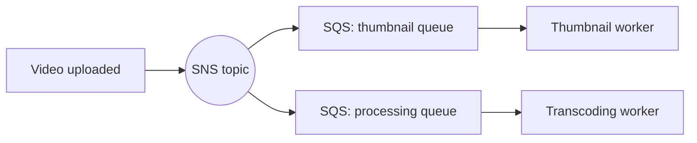
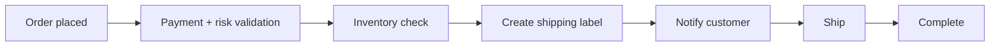

# AWS Databases & Application Integration — Need to Knows

Quick revision notes for the exam. Each section covers **what the service is**, **when to pick it**, and the **key facts** that tend to show up in questions.

---

## 1. Amazon RDS (Relational Database Service)

Use RDS for **relational (SQL) database** requirements when you don't want to manage the database server yourself.

### Why it exists

Running a database on EC2 means *you* handle OS and DB patching, backups, upgrades, replication and failover. RDS takes over that routine administration so you only manage the schema, queries and settings.

### What you get

| Feature | Details |
|---|---|
| **Routine operations** | Automated patching, minor version upgrades, maintenance windows |
| **High availability** | Multi-AZ deployments with automatic failover |
| **Scalability** | Scale instance size (vertical), add read replicas (horizontal reads), storage auto-scaling |
| **Backup & restore** | Automated backups (retention 1–35 days) with **point-in-time restore**; manual snapshots kept until you delete them |
| **Monitoring** | CloudWatch metrics, Enhanced Monitoring (OS-level), Performance Insights |
| **Security** | Runs in your VPC, security groups, encryption at rest (KMS), TLS in transit, IAM database authentication |

### Supported engines

MySQL, PostgreSQL, MariaDB, Oracle, Microsoft SQL Server, IBM Db2, and **Amazon Aurora** (MySQL and PostgreSQL compatible).

### Instance classes

| Class | Family | Use for |
|---|---|---|
| **General purpose** | `db.m*` | Balanced CPU and memory; most workloads |
| **Memory optimized** | `db.r*`, `db.x*` | Memory-heavy workloads, large caches and datasets |
| **Burstable** | `db.t*` | Dev/test, small or spiky workloads (CPU credits) |

Storage options: **General Purpose SSD (gp2/gp3)** and **Provisioned IOPS SSD (io1/io2)** for I/O-intensive workloads.

### Deployment types

| Deployment | How it works | Standby readable? | Purpose |
|---|---|---|---|
| **Single-AZ** | One DB instance in one AZ | — | Dev/test, lowest cost, no automatic failover |
| **Multi-AZ DB instance** | Primary + **one standby** in another AZ, **synchronous** replication | ❌ No | High availability / disaster recovery; automatic failover (~1–2 min), same DNS endpoint |
| **Multi-AZ DB cluster** | One writer + **two readable standbys** across 3 AZs | ✅ Yes | HA **and** read scaling; faster failover (typically < 35 s); MySQL & PostgreSQL only |

### Read replicas (separate from Multi-AZ)

- **Asynchronous** replication → used for **read scaling**, not HA.
- Up to **15** read replicas (MySQL, MariaDB, PostgreSQL; Aurora also 15).
- Can be in the same AZ, a different AZ, or **another Region** (cross-Region DR / lower latency for global readers).
- Each replica has its **own endpoint**; the application must send reads to it.
- A replica can be **promoted** to a standalone database.

!!! tip "Exam tip: Multi-AZ vs Read Replica"
    - **Multi-AZ** = availability (synchronous, failover). The classic standby does *not* serve reads.
    - **Read replica** = performance (asynchronous, serves reads).
    - "Improve read performance" → read replicas. "Survive an AZ failure" → Multi-AZ.

### Other RDS points worth knowing

- **Encryption** must be enabled **at creation**. To encrypt an existing DB: snapshot → copy the snapshot with encryption → restore.
- **RDS Proxy** pools DB connections. Useful with Lambda or apps that open many short-lived connections; also speeds up failover.
- **RDS Custom** (Oracle, SQL Server) gives you OS and DB access for apps that need custom settings.
- **Amazon Aurora**: storage keeps 6 copies across 3 AZs and grows automatically up to 128 TiB; up to 15 low-latency replicas; **Aurora Serverless v2** for variable workloads; **Aurora Global Database** for cross-Region (typically < 1 s lag).

### Other AWS database services (pick by use case)

| Need | Service |
|---|---|
| Relational / SQL, OLTP | RDS, Aurora |
| Key-value / NoSQL, single-digit ms at any scale, serverless | **DynamoDB** (DAX for microsecond caching) |
| In-memory cache, session store | **ElastiCache** (Redis OSS / Valkey / Memcached), **MemoryDB** (durable Redis-compatible) |
| Data warehouse, analytics (OLAP) | **Redshift** |
| Document (MongoDB compatible) | **DocumentDB** |
| Graph (relationships, social networks, fraud) | **Neptune** |
| Wide-column (Apache Cassandra compatible) | **Keyspaces** |
| Time series (IoT, metrics) | **Timestream** |

---

## 2. Scaling & Load Balancing

### Auto Scaling (EC2 Auto Scaling)

- Automatically adds or removes EC2 instances in an **Auto Scaling group** to match demand.
- Settings: **minimum / desired / maximum** capacity; uses a launch template.
- Scaling policies: **target tracking** (e.g. keep CPU at 50%), **step/simple**, **scheduled**, **predictive**.
- Replaces unhealthy instances automatically; works with ELB health checks.

### Elastic Load Balancing (ELB)

Spreads incoming traffic across multiple targets (EC2, containers, IPs, Lambda) in one or more AZs.

| Load balancer | OSI layer | Key features | Typical use |
|---|---|---|---|
| **Application LB (ALB)** | Layer 7 (HTTP/HTTPS, gRPC, WebSocket) | Path-, host- and header-based routing; Lambda targets | Web apps, microservices, containers |
| **Network LB (NLB)** | Layer 4 (TCP/UDP/TLS) | Ultra-low latency, millions of req/s, **static IP / Elastic IP per AZ**, preserves source IP | Gaming, IoT, non-HTTP, partners who must allow-list a fixed IP |
| **Gateway LB (GWLB)** | Layer 3 (IP, GENEVE) | Sends traffic through third-party appliances | Firewalls, intrusion detection |
| Classic LB | L4/L7 | Legacy | Avoid for new designs |

!!! note "Elastic IPs with NLB"
    An NLB can take **one Elastic IP per AZ**, so clients get a **fixed public IP** (handy for firewall allow-lists). ALBs only give you a DNS name. Their IPs change.

---

## 3. Application Integration Services

### Amazon API Gateway

- Fully managed service to **create, publish, secure and monitor APIs** at any scale.
- API types: **REST API**, **HTTP API** (cheaper, simpler), **WebSocket API** (two-way, real-time).
- Features: throttling/rate limits, caching, request validation, API keys & usage plans, stages (dev/prod).
- Auth: IAM, Amazon Cognito, Lambda authorizers.
- Classic serverless pattern (CRUD demo): **API Gateway → Lambda → DynamoDB**.

### Amazon AppFlow

- **No-code, fully managed data transfer between SaaS apps and AWS services** (e.g. Salesforce, SAP, Slack, Zendesk, ServiceNow ↔ S3, Redshift).
- Runs on demand, on a schedule, or on an event; can filter, map and validate data.
- Data encrypted in transit and at rest; can use **AWS PrivateLink** so traffic stays off the public internet.

### Amazon SNS & Amazon SQS

| | **SNS** (Simple Notification Service) | **SQS** (Simple Queue Service) |
|---|---|---|
| Model | **Pub/Sub**, **push**. A publisher sends to a **topic**, and every subscriber gets a copy | **Queue**, **pull**. Consumers poll and process messages |
| Delivery | To SQS, Lambda, HTTP(S), email, SMS, mobile push | One consumer processes each message |
| Persistence | No storage. Messages are delivered and gone | Messages kept until deleted (default 4 days, **max 14 days**) |
| Use | Fan-out, notifications, alerts | Decouple producers from consumers, buffer load, smooth spikes |

**SQS key facts**

- **Standard queue**: nearly unlimited throughput, **at-least-once** delivery, best-effort ordering.
- **FIFO queue**: **strict ordering**, **exactly-once** processing, lower throughput (300 msg/s, 3,000 with batching; higher in high-throughput mode).
- **Visibility timeout** (default 30 s): hides a message while a consumer works on it.
- **Dead-letter queue (DLQ)**: collects messages that keep failing.
- **Long polling** cuts down empty responses and cost.

**Fan-out pattern (SNS + SQS)**: one event, several independent consumers.

Each queue gets its own copy of the message, so a slow or failed worker doesn't affect the others.

### Amazon MQ

- Managed message broker for **Apache ActiveMQ** and **RabbitMQ**.
- Supports industry-standard protocols: **AMQP, MQTT, OpenWire, STOMP, JMS**. Apps written in different languages and frameworks can talk through a common protocol.
- Best for **migrating existing on-prem apps** that already use a broker (lift and shift, no code rewrite).
- For **new cloud-native apps**, SNS + SQS is usually the better choice: simpler, serverless, and scales almost without limit.

!!! tip "Exam tip"
    "Migrate an app that uses JMS / AMQP / MQTT / RabbitMQ / ActiveMQ" → **Amazon MQ**. Otherwise → **SNS / SQS**.

### Amazon EventBridge

Serverless **event bus** that connects applications using events. Producers and consumers don't need to know about each other, so tightly coupled apps can become **loosely coupled**.

| Component | What it does |
|---|---|
| **Event bus** | Receives events from AWS services (default bus), your own apps (custom bus), or **SaaS partners** (partner bus). **Rules** match events by pattern and route them to targets (Lambda, SQS, Step Functions, etc.) |
| **Pipes** | **Point-to-point** integration: source → filter → enrich/transform → target, no glue code needed |
| **Scheduler** | Serverless scheduler (cron, rate, or one-time) for millions of schedules, with **retries** and DLQ |

**Features**

- Low-cost, serverless integration (pay per event).
- **Archive & Replay**: store events and replay them later for debugging or recovery.
- **Schema Registry**: discovers and stores event structures and generates code bindings.
- Built-in **retries** and dead-letter queues.

!!! note "EventBridge vs SNS"
    Both route events to many targets. EventBridge offers **richer content-based filtering**, **SaaS sources**, schema registry and replay. SNS has **higher throughput / lower latency** and direct SMS, email and mobile push.

### Amazon SES (Simple Email Service)

- Cloud email service that runs on AWS infrastructure: **transactional** (receipts, password resets), **marketing**, and bulk email; can also **receive** email.
- Integrates with SNS, S3, Lambda; send via SMTP or API.
- Deliverability tools: **SPF, DKIM, DMARC**, reputation dashboard, dedicated IPs.
- New accounts start in a **sandbox** (verified recipients only) until you request production access.

---

## 4. Workflow Orchestration

### AWS Step Functions

Serverless **visual workflow orchestration**. It solves the problem of coordinating complex workflows that span many components and services.

- Workflows are **state machines** defined in **Amazon States Language (JSON)**; you can inspect every execution step by step in the console.
- State types: Task, Choice (branching), **Parallel**, **Map** (loop over items), Wait, Pass, Succeed/Fail.
- **Error handling** is built in: `Retry` (with backoff) and `Catch` (fallback / escalation paths).
- **Human approval** steps via callback with a task token.
- Integrates with **220+ AWS services** and **10,000+ API actions**.

| Workflow type | Max duration | Execution guarantee | Use |
|---|---|---|---|
| **Standard** | Up to 1 year | Exactly-once | Long-running jobs, ETL, human approval |
| **Express** | Up to 5 minutes | At-least-once | High-volume, short event processing (IoT, streaming) |

**Example: order processing workflow**

Other use cases: long-running **ETL jobs**, **automations that need manual approval**, ML pipelines, microservice orchestration.

### Amazon SWF (Simple Workflow Service)

- The older workflow service. **You write the coordination logic in code** (deciders + activity workers) in a programming language of your choice.
- Choose SWF when you need **child workflows (child processes)**, **external signals** to step into a running workflow, or **interaction with outside entities / human tasks** that require custom code.
- AWS recommends **Step Functions for new applications**.

### Amazon MWAA (Managed Workflows for Apache Airflow)

- Managed **Apache Airflow**. AWS runs the scheduler, workers and web server, and **scales workers automatically** on managed infrastructure.
- Workflows are **DAGs written in Python**, stored in S3.
- Best for teams **already using Airflow**, or for complex data/ETL pipelines that need the open-source Airflow ecosystem and plugins.

### Choosing a workflow service

| Requirement | Pick |
|---|---|
| New serverless workflow, visual, deep AWS integration | **Step Functions** |
| Child workflows, external signals, custom code-driven coordination | **SWF** |
| Existing Airflow DAGs / open-source portability, Python data pipelines | **MWAA** |

---

## Quick decision cheat sheet

| Scenario | Answer |
|---|---|
| Managed relational DB, minimal admin | RDS / Aurora |
| Survive AZ failure for a DB | RDS Multi-AZ |
| Scale database reads | Read replicas (or Multi-AZ DB cluster) |
| Decouple components with a buffer | SQS |
| One message to many subscribers | SNS (fan-out to SQS) |
| Strict ordering, no duplicates | SQS FIFO |
| Migrate an app using ActiveMQ/RabbitMQ | Amazon MQ |
| React to AWS/SaaS events, content-based routing | EventBridge |
| Run tasks on a schedule (serverless) | EventBridge Scheduler |
| Sync SaaS data (Salesforce, etc.) to AWS without code | AppFlow |
| Expose a REST/WebSocket API in front of Lambda | API Gateway |
| Send transactional / marketing email | SES |
| Orchestrate multi-step workflow with retries & approvals | Step Functions |
| Fixed IP for a load balancer | NLB with Elastic IPs |
| Path-based HTTP routing | ALB |
