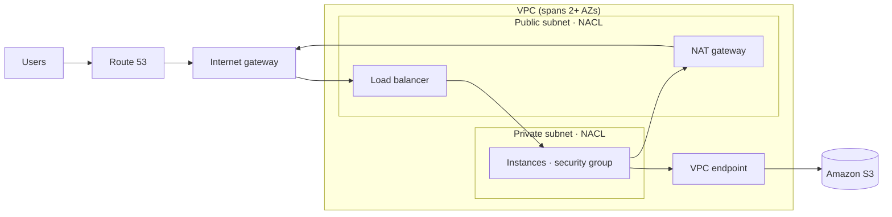

# Designing for Security on AWS

Quick revision notes for the Solutions Architect exam. Where [Security services](security-services.md) covers the individual tools, this page is about **how to think**: the design principles, the areas every secure workload covers, who is responsible for what, and how those ideas turn into a secure network.

## What security actions affect

Every security decision lands in one (or more) of four areas:

| Area | Question it answers | Example services |
|---|---|---|
| **Identity & access management** | Who can do what? | IAM, Identity Center, Organizations SCPs |
| **Detection** | How do we know something is wrong? | CloudTrail, Config, GuardDuty, Security Hub |
| **Protection** | How do we stop it happening? | Security groups, WAF, Shield, KMS |
| **Response** | What do we do when it happens? | EventBridge + Lambda, Systems Manager, Detective |

---

## Design principles: SAPTRAP

A handy mnemonic for the security design principles of the AWS Well-Architected Framework:

| Letter | Principle | In practice |
|---|---|---|
| **S** | **Strong identity foundation** | Least privilege, central identity (Identity Center), roles not long-term keys, MFA |
| **A** | **Apply security at all layers** | Edge, VPC, subnet, load balancer, instance, OS, app, data: defence in depth |
| **P** | **Prepare for security events** | Incident playbooks, game days, DR tests, tools pre-deployed |
| **T** | **Traceability** (track everything relevant) | CloudTrail, VPC Flow Logs, access logs, alerts on changes |
| **R** | **Reduce direct human access** | No manual changes or SSH into prod; use Systems Manager, IaC, pipelines |
| **A** | **Automate security best practices** | Config rules, Lambda auto-remediation, guardrails in Control Tower |
| **P** | **Protect data in all states** | Classify data; encrypt **at rest** (KMS) and **in transit** (TLS) |

---

## The seven security areas

Check your cloud setup against each of these (they're the best-practice areas of the Well-Architected security pillar):

1. **Security foundations**: multi-account structure (Organizations, Control Tower), ownership, keeping up with threats and the *who, what, when*.
2. **Identity & access management**: human and machine identities, least privilege, permission guardrails.
3. **Detection**: logging, monitoring and alerting on unexpected activity or configuration.
4. **Infrastructure protection**: network layers, firewalls, hardened and patched compute.
5. **Data protection**: classification, encryption at rest and in transit, backups.
6. **Application security**: secure code, dependency scanning, security in the CI/CD pipeline.
7. **Incident response**: prepared runbooks, automated containment, practice through simulations.

---

## Shared responsibility model

**AWS** is responsible for security **of** the cloud (hardware, facilities, global network, the virtualisation layer). **You** are responsible for security **in** the cloud. How much falls on you depends on how managed the service is:

| Service model | Rough split (you / AWS) | Example | You still own |
|---|---|---|---|
| **Infrastructure (IaaS)** | ~90 / 10 | EC2 | Guest OS patching, firewall/SG config, apps, data, IAM, encryption |
| **Platform (PaaS)** | ~50 / 50 | RDS, Elastic Beanstalk | DB users, network access, parameter settings, data, encryption choice |
| **Managed / serverless** | ~10 / 90 | S3, DynamoDB, Lambda | Data, access policies (IAM, bucket policies), encryption settings, code |

!!! tip "Exam tip"
    Whatever the service, **your data, IAM and how you configure access are always yours**. "Who patches the OS on EC2?" → **you**. "Who patches the OS on RDS?" → **AWS**.

---

## Securing network services

Network security has three goals: **secure access** to AWS resources, **secure the workloads**, and **secure the data** moving between them.

### Know your network security building blocks

| Building block | Role |
|---|---|
| **Public / private subnets** | Only load balancers and NAT live in public subnets; apps and databases stay private |
| **NACL** | Stateless subnet-level firewall; allow and deny rules |
| **Security group** | Stateful instance-level firewall; allow rules, can reference other SGs |
| **NAT gateway** | Outbound-only internet for private subnets |
| **VPC endpoints** | Reach S3/DynamoDB and other AWS services without the internet |
| **Site-to-Site VPN** | Encrypted tunnel from on-prem to the VPC |
| **Direct Connect** | Private dedicated link (add MACsec or VPN for encryption) |
| **VPC Flow Logs** | Record accepted/rejected IP traffic for troubleshooting and forensics |
| **AWS Network Firewall** | Managed stateful firewall with intrusion prevention and domain filtering at the VPC level |
| **Gateway Load Balancer** | Transparently route traffic through third-party firewall/IDS appliances |

### Layers of a secure VPC

Traffic passes through several layers on its way in, so a mistake in one layer is caught by the next:

- Spread public and private subnets over **at least two AZs**, each with its own NAT gateway.
- Only the load balancer is reachable from the internet; instances accept traffic **only from the load balancer's security group**.
- Private instances reach S3 through a **VPC endpoint**, not the internet.
- Turn on **VPC Flow Logs**, and add **WAF** on the load balancer/CloudFront and **Network Firewall** for inspection where needed.

---

## Applying it day to day

- [ ] Every account in an Organization, with SCP guardrails and CloudTrail enabled org-wide.
- [ ] Humans sign in through Identity Center with MFA; workloads use IAM roles.
- [ ] No resources in public subnets except load balancers and NAT gateways.
- [ ] Encryption at rest (KMS) and TLS everywhere.
- [ ] GuardDuty, Security Hub and Config turned on, with alerts going somewhere someone reads.
- [ ] Changes go through IaC and pipelines, not the console or SSH.
- [ ] An incident runbook exists and has been practised.

## Quick decision cheat sheet

| Scenario | Answer |
|---|---|
| Who patches the guest OS on EC2? | You (customer) |
| Who patches the OS and database engine on RDS? | AWS |
| Who is responsible for data and access policies on S3? | You |
| Defence in depth for a web app | CloudFront + WAF → ALB in public subnet → instances in private subnet with SGs |
| Remove manual SSH access to servers | Systems Manager Session Manager |
| Automatically fix non-compliant resources | Config rules + auto-remediation (SSM/Lambda) |
| Trace who changed what | CloudTrail (+ Config for resource history) |
| Investigate network traffic to an instance | VPC Flow Logs |
| Inspect and filter VPC traffic centrally | AWS Network Firewall |
| Use existing third-party firewall appliances | Gateway Load Balancer |
| Keep traffic to S3 off the internet | VPC gateway endpoint |
