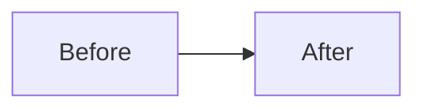

# <Outcome-focused title>

**Type:** <Production experience | Evaluation / POC> · **Role:** <your role> · **Stack:** <main tools>

## Context
The situation and constraints. Generalize; never include employer names, hostnames or internal identifiers.

## Problem
What needed to change, and why it mattered.

## Approach
1. Steps taken.

## Engineering decisions
- **Decision:** why this, and what alternatives were rejected.

## Results
Measurable outcomes where possible (approximate figures are fine; say so).

## What I learned
Lessons you'd apply next time.
